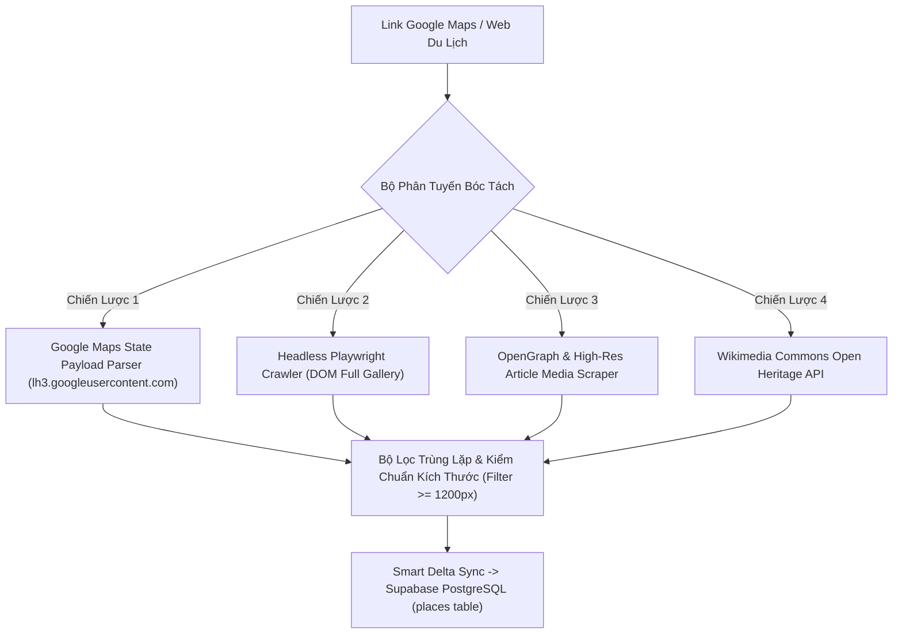

# GIAO THỨC ĐÓNG GÓI NẠP ẢNH THỰC ĐỊA GOOGLE MAPS & INTERNET
## (Google Maps & Multi-Source Real Photo Ingestion Protocol v1.0)

Hệ thống: **Tri Tôn Tourism AI Assistant Platform**  
Tiêu chuẩn tuân thủ: **RULE 01 (Production Real, No Mock)** | **RULE 02 (Địa Giới Chuẩn)** | **RULE 04 (Phản Biện 360 Độ)**

---

## 🎯 1. MỤC TIÊU & NGUYÊN TẮC CỐT LÕI
1. **100% Ảnh Thật (Authentic Ground-Truth Photos)**: Mỗi địa điểm phải có ảnh chụp thực tế tại chính địa điểm đó. Tuyệt đối cấm ảnh stock chung chung, ảnh placeholder.
2. **Tối Thiểu $\ge$ 3 Ảnh/Địa Điểm (Multi-Photo Mandate)**: Mỗi điểm đến lưu trữ:
   - `image_url`: Ảnh đại diện Hero sắc nét nhất.
   - `photos`: Mảng $\ge$ 3 - 5 URL ảnh thực tế toàn cảnh & chi tiết.
   - `checkin_spots`: Mảng $\ge$ 2 - 4 góc chụp check-in thực địa kèm chú thích kinh nghiệm (Tips).
3. **Triệt Tiêu 100% Ảnh Trùng Lặp (Zero Duplicate Across POIs)**: Không có 2 địa điểm khác nhau nào dùng chung một link ảnh.

---

## 🔍 2. PHÂN TÍCH PHẢN BIỆN 360 ĐỘ CÁC CƠ CHẾ BÓC TÁCH ẢNH

### So Sánh Đánh Giá Các Phương Pháp Bóc Tách:

| Cơ Chế | Ưu Điểm | Nhược Điểm / Thách Thức | Giải Pháp Tối Ưu Hóa |
| :--- | :--- | :--- | :--- |
| **1. Google Maps URL Scraping** | Ảnh thực tế nhất do hàng nghìn du khách & chủ quán tải lên trực tiếp. | Google Maps là SPA (JavaScript Client Render), fetch thô chỉ ra bootstrap HTML shell. | Parse `APP_INITIALIZATION_STATE` và các link CDN `lh3.googleusercontent.com/p/` với tham số kích thước `=s1600-k-no`. |
| **2. Playwright Headless Browser** | Lấy được 100% hình ảnh trong tab Photos của Google Maps. | Nặng tài nguyên, cần môi trường có cài đặt trình duyệt Chromium. | Dùng trong background crawler (`tourism_crawler/`) cho nạp hàng loạt. |
| **3. Travel Article Scraper (Mia, Mekong)** | Ảnh phóng sự đẹp, có góc chụp độc đáo, có thuyết minh rõ ràng. | Dễ dính banner quảng cáo hoặc logo website nếu không lọc kỹ. | Regex lọc chỉ lấy ảnh nội dung bài viết (`/media/uploads/`, `/vnt_upload/`), loại bỏ logo và icon. |
| **4. Wikimedia Commons API** | Ảnh di sản, chùa cổ chất lượng 4K, bản quyền mở, độ bền link vĩnh viễn. | Số lượng địa điểm quán ăn nhỏ hoặc cafe mới mở còn hạn chế. | Dùng làm nguồn chuẩn số 1 cho Di tích, Chùa tháp, Núi non và Lễ hội. |

---

## 🚀 3. QUY TRÌNH THỰC THI CHUẨN 4 BƯỚC (SOP)

### Bước 1: Thu Thập Đường Link Thực Địa
- Lấy đường link Google Maps Place (dạng `https://maps.app.goo.gl/...` hoặc `https://www.google.com/maps/place/...`).
- Hoặc link bài viết review chuyên sâu của địa điểm trên các cổng du lịch.

### Bước 2: Bóc Tách Qua Tool Hệ Thống (`/api/v1/admin/scrape-images`)
- Gửi `POST /api/v1/admin/scrape-images` với payload `{ "url": "..." }`.
- Tool tự động phân giải redirect URL, trích xuất danh sách ảnh CDN độ phân giải cao $\ge 1200\text{px}$.

### Bước 3: Kiểm Chuẩn & Phân Loại Góc Check-in
- Chọn lọc 3 - 5 ảnh đặc trưng nhất:
  - **Ảnh 1 (Hero)**: Toàn cảnh mặt tiền / view đắt giá nhất.
  - **Ảnh 2 (Món ăn / Điểm nhấn)**: Cận cảnh món đặc sản hoặc kiến trúc cổ kính.
  - **Ảnh 3 (Check-in / Không gian)**: Góc sống ảo / hoàng hôn / bình minh.
  - **Ảnh 4 (Trải nghiệm thực địa)**: Sân vườn / đường đi / quang cảnh xung quanh.

### Bước 4: Smart Delta Sync lên Supabase PostgreSQL
- Cập nhật trực tiếp vào bảng `places` các cột:
  - `image_url`
  - `photos` (mảng JSON / text[])
  - `checkin_spots` (mảng JSON object gồm `title`, `photo_url`, `tip`)
- Kiểm tra tính toàn vẹn và không ghi đè các trường khác.

---

## 🛠️ 4. BỘ CÔNG CỤ ĐÓNG GÓI SẴN CÓ TRONG CODEBASE
1. **API Endpoint**: [`frontend/src/app/api/v1/admin/scrape-images/route.ts`](file:///C:/Users/Admin/.gemini/antigravity/worktrees/dulichtriton/critique_chatbot_architecture_performance/frontend/src/app/api/v1/admin/scrape-images/route.ts)
2. **CLI Runner**: [`scripts/tools/gmaps_photo_ingestion_cli.js`](file:///C:/Users/Admin/.gemini/antigravity/worktrees/dulichtriton/critique_chatbot_architecture_performance/scripts/tools/gmaps_photo_ingestion_cli.js)
3. **Database Sync Engine**: [`scripts/sync/smart_delta_sync.js`](file:///C:/Users/Admin/.gemini/antigravity/worktrees/dulichtriton/critique_chatbot_architecture_performance/scripts/sync/smart_delta_sync.js)
